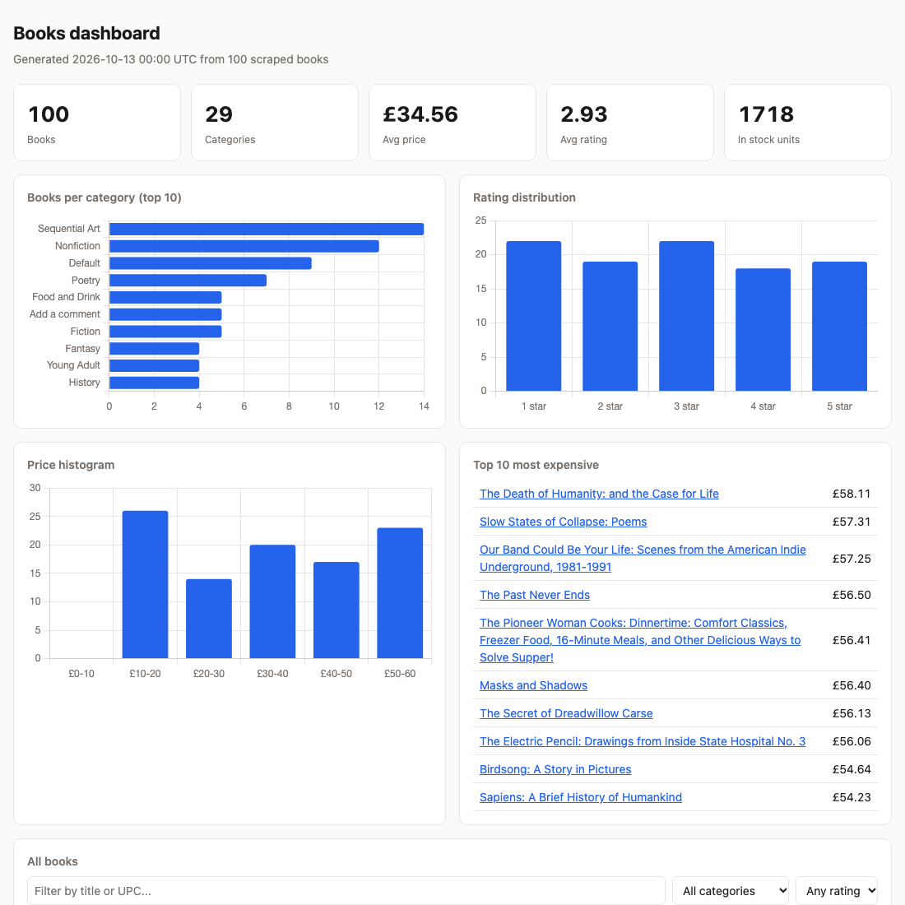

# scrape-to-dashboard

A small end-to-end data pipeline: **polite scraper -> validated ETL into SQLite -> static HTML dashboard + CSV**.

> Demo by Simon Dziak (App369). It targets [books.toscrape.com](https://books.toscrape.com/), a public sandbox built for scraping practice. Real-world scraping must follow each site's terms of service, robots.txt and applicable law; this repo is a portfolio demo, not a claim about any client work.



Sample output from a `--limit 100` run is committed in [`sample/`](sample/): [`index.html`](sample/index.html) (open it locally in a browser; charts load Chart.js from a CDN) and [`books.csv`](sample/books.csv).

## Run it

Requires Node 22.5+ (uses the built-in `node:sqlite`, so no native modules).

```bash
npm install
npm run scrape -- --limit 100      # crawl into data/books.db
npm run dashboard                  # writes dist/index.html and dist/books.csv
npm test                           # offline, runs against saved HTML fixtures
npm run typecheck
```

Scrape flags: `--limit N` (new books per run, default 100), `--concurrency 2`, `--delay 500` (ms between requests per worker), `--retries 3`, `--db data/books.db`, `--refresh` (re-fetch already-scraped URLs to record price changes).

## What it extracts

Per book: title, price (number), currency, rating (1-5, from the CSS class), availability count, category, product URL, UPC, `scraped_at`.

## Design notes

- **Politeness.** Clear `User-Agent`, low default concurrency (2) plus a per-request delay, `Crawl-delay` honored if robots.txt sets one. `robots.txt` is fetched first and parsed by a small purpose-built parser (`src/robots.ts`: agent groups, `Allow`/`Disallow`, `*` and `$`, longest match wins). Disallowed URLs are never requested. A missing robots.txt (this site returns 404) means no restrictions.
- **Retries.** Exponential backoff on 5xx, 429, network errors and timeouts; other 4xx fail fast. Failed URLs land in `rejects` instead of aborting the run.
- **Resumable.** URLs already in `books` are skipped, so an interrupted run can simply be restarted. `--limit` counts *new* books, so repeated runs keep extending the dataset.
- **Validation.** Raw strings are normalized (`£51.77` -> `51.77` / `GBP`, `star-rating Three` -> `3`, `In stock (22 available)` -> `22`) and validated with zod. Rows that fail go to a `rejects` table with the reason and raw payload.
- **Idempotent upserts.** `books` is keyed on UPC (`INSERT ... ON CONFLICT DO UPDATE`). `price_history` gets a row on first sight and whenever the price changes, so re-running with `--refresh` never duplicates rows but does capture price movement.
- **Dashboard.** `src/dashboard.ts` embeds the data as JSON into one self-contained HTML file (inline CSS/JS, Chart.js via CDN): totals, books per category, rating distribution, price histogram, top 10 most expensive, and a sortable/filterable table. Light and dark mode.

## Layout

```
src/robots.ts     robots.txt parser        src/db.ts         schema + upserts
src/http.ts       fetch, retries, UA       src/crawl.ts      crawler orchestration
src/parse.ts      cheerio extraction       src/dashboard.ts  HTML + CSV output
src/schema.ts     normalize + zod          src/cli.ts        scrape entry point
test/             vitest, offline fixtures
```

## Notes

- The site's `Default` category is a quirk of the sandbox data, not a parsing bug.
- Prices on the sandbox are fictional.

MIT licensed, see [LICENSE](LICENSE).
